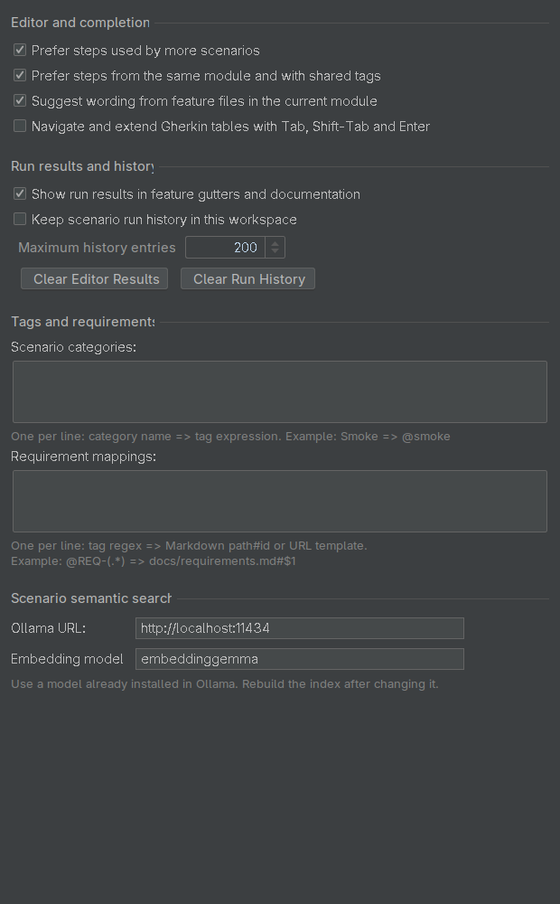

# Configuration

Open **Settings → Scala Cucumber** for project settings. Changes take effect when you
click **Apply** or **OK**; result/history clearing acts immediately.



## Editor and completion

| Setting | Default | Effect |
| --- | --- | --- |
| **Show frequently used step definitions higher in autocomplete** | On | Gives a larger boost to definitions used by more scenarios. Outlines count once; ambiguous matches are included. |
| **Show steps from this module or with shared tags higher in autocomplete** | On | Raises definitions in the current IntelliJ module and those used by scenarios sharing tags with yours, such as `@payments`. |
| **Include unimplemented steps from existing feature files in autocomplete** | On | Suggests step text with no matching Scala definition from the current module and its dependencies, marked **Feature wording · undefined**. Accepting inserts text only. |
| **Navigate table cells with Tab, Shift-Tab and Enter** | Off | Tab selects the next cell, Shift-Tab the previous cell, and Enter the cell below. Moving past the last row adds an empty row. See [cell navigation and keyboard clearing](editing.md#keyboard-navigation). |

The first three settings control autocomplete in `.feature` files. Ranking changes
suggestion order; it does not change which Scala definition runs.

## Run results and history

| Setting or action | Default | Effect |
| --- | --- | --- |
| **Show run results in feature gutters and documentation** | On | Displays the latest recorded results in the editor and Quick Documentation. |
| **Keep scenario run history in this workspace** | Off | Retains scenario outcomes locally for the [Run History tab](workspace.md#run-history). |
| **Maximum history entries:** | 200 | Limits retained entries, removing the oldest first. Accepts 0–10000; 0 retains none. Available when history is enabled. |
| **Clear Editor Results** | — | Clears session results, including failure-explanation context, immediately; saved history remains. |
| **Clear Run History** | — | Deletes retained history immediately; active runs keep their errors and can add new entries when they finish. |

History is local to the IDE workspace, stored in `.idea/workspace.xml` for a
directory-based project. Clearing editor results and clearing saved history are
separate actions. Turning history off stops retention; use **Clear Run History**
when you also want to remove existing entries.

## Scenario categories

Use **Tags and requirements → Scenario categories:** to name groups of scenarios
based on their tags. This is optional; leave the field empty if you do not need
custom groups. Enter one mapping per line:

```text
Smoke => @smoke
Payments => @payments and not @ignored
```

The left side is the group name; the right side selects tags. Combine tags with
`and`, `or`, `not` and parentheses. For example, a scenario tagged `@smoke @payments`
appears in both groups; adding `@ignored` excludes it from **Payments**.

Open **Scala Cucumber → Suite**, select **Scenarios**, then **Group → Category**.
Unmatched scenarios appear as **Uncategorized**. Blank lines and invalid mappings
do not create a category.

## Requirement mappings

Use **Tags and requirements → Requirement mappings:** to link feature tags to
specifications or issues. This is optional; leave the field empty if you do not
use these links. Enter one mapping per line: a tag pattern (regular expression)
on the left and a Markdown destination or URL on the right.

```text
@REQ-(.*) => docs/requirements.md#$1
@ISSUE-(\d+) => https://tracker.example.com/issues/$1
```

In the first mapping, `(.*)` captures any text after `@REQ-`, and `$1` inserts that
text into the destination. For example:

```gherkin
@REQ-PAY-12
Scenario: Pay by card
  When I pay with a valid card
  Then the payment is accepted
```

This tag links to `docs/requirements.md#PAY-12`. Create `docs/requirements.md` with
a matching heading, for example:

```markdown
## PAY-12
A valid card payment must be accepted.
```

Use [Go to Declaration on the tag](navigation.md#requirements) to open that heading.
In the second mapping, `(\d+)` captures digits: `@ISSUE-123` opens
`https://tracker.example.com/issues/123` after confirmation in **Open Requirement URL**.

Patterns must match the entire tag, including `@`. The first matching mapping wins.
`$1`, `$2` and later references insert the corresponding parenthesized captures.
Blank lines and lines beginning with `#` are ignored.

Local paths are resolved from the project and content roots. A local destination
requires `#id`; the ID can match a Markdown heading's text, a `{#PAY-12}` heading
anchor or an HTML `id="PAY-12"` anchor. If several anchors match, navigation offers
the candidates. A missing local destination is reported by **Missing configured requirement**.

## Scenario semantic search

| Field | Default | Meaning |
| --- | --- | --- |
| **Ollama URL:** | `http://localhost:11434` | Server receiving scenario text during index rebuilding and query text during semantic searches. |
| **Embedding model:** | `embeddinggemma` | Name of an embedding model already installed in that Ollama server. |

An embedding model represents text numerically so related wording can be compared.
The plugin does not download models. Prepare the server and model using
[installation](installation.md#prepare-optional-semantic-search), then follow the
[search workflow](workspace.md#semantic-search). Requests occur when you explicitly
rebuild or perform a semantic search. Changing the server or model requires a new index.

## Failure explanations

| Setting or action | Default | Effect |
| --- | --- | --- |
| **Enable failure explanations** | Off | Offers [Explain Cucumber Failure](running.md#explain-a-failure) and retains recent results even when gutter result display is off. No model request is automatic. |
| **Ollama URL:** | `http://localhost:11434` | Local or remote Ollama-compatible chat server receiving the reviewed context. Independent of the semantic-search server. |
| **Chat model:** | `llama3.2:3b` | Installed chat model used for explanations. Prepare it as described in [installation](installation.md#prepare-optional-chat-models). |
| **Access token (optional):** | Blank | Leave blank for local Ollama. Used only for a protected server; saved tokens are masked. |

Clear the token field to remove a saved token, or enter a replacement. Token
changes require **Apply** or **OK**; cancelling discards pending changes. Tokens are
stored in IDE Password Safe and excluded from project XML. Changing the server or
chat model requires closing an existing review window and opening a new request.

## Edge-case drafts

| Setting | Default | Effect |
| --- | --- | --- |
| **Enable edge-case scenario drafts** | Off | Offers [Suggest edge cases](editing.md#suggest-edge-case-scenarios) in feature files. Requests require context review and explicit generation. |
| **Ollama URL:** | `http://localhost:11434` | Ollama-compatible server receiving the reviewed specification. Independent of search and failure-explanation settings. |
| **Chat model:** | `llama3.2:3b` | Installed chat model supporting JSON output. See [chat-model setup](installation.md#prepare-optional-chat-models). |
| **Access token (optional):** | Blank | Leave blank for local Ollama. Used only for a protected draft-generation server; saved tokens are masked. |

Draft tokens are separate from failure-explanation tokens and excluded from project
XML. Clear the token field to remove a saved token, or enter a replacement.
Changes require **Apply** or **OK**; cancelling discards pending changes.

## Project configuration file

For directory-based projects, the settings above are stored in
**`.idea/scala-cucumber.xml`**, in the **`ScalaCucumberSettings`** component.
Use the settings page for normal editing. For example, the following enables table
navigation and changes the search server:

```xml
<project version="4">
  <component name="ScalaCucumberSettings">
    <option name="tableNavigation" value="true" />
    <option name="ollamaUrl" value="http://localhost:11434" />
    <option name="embeddingModel" value="embeddinggemma" />
  </component>
</project>
```

| XML option | Settings control |
| --- | --- |
| `rankByReuse` | Show frequently used step definitions higher in autocomplete |
| `rankByContext` | Show steps from this module or with shared tags higher in autocomplete |
| `featureWording` | Include unimplemented steps from existing feature files in autocomplete |
| `tableNavigation` | Navigate table cells with Tab, Shift-Tab and Enter |
| `resultDecorations` | Show run results in feature gutters and documentation |
| `runHistory` | Keep scenario run history in this workspace |
| `historyRetention` | Maximum history entries |
| `tagCategories` | Scenario categories, as newline-separated mappings |
| `requirementMappings` | Requirement mappings, as newline-separated mappings |
| `ollamaUrl` | Ollama URL |
| `embeddingModel` | Embedding model |
| `failureExplanations` | Enable failure explanations |
| `explanationUrl` | Failure explanations: Ollama URL |
| `explanationModel` | Chat model |
| `scenarioDrafts` | Enable edge-case scenario drafts |
| `draftUrl` | Edge-case drafts: Ollama URL |
| `draftModel` | Edge-case drafts: Chat model |

## Inspections

Open **Settings → Editor → Inspections** to enable or disable the plugin's inspections:

| Inspection | Default | Options |
| --- | --- | --- |
| **Cucumber step lambda signature** | On | None |
| **Examples header consistency** | On | None |
| **Explicit DataTable header mapping** | On | None |
| **Missing configured requirement** | On | Uses the requirement mappings above. |
| **Project Gherkin style** | Off | Controls below. |

**Project Gherkin style** provides:

| Option | Default |
| --- | --- |
| **Require scenario titles** | On |
| **Report duplicate tags** | On |
| **Maximum steps per scenario** | 12; accepts 1–10000 |
| **Require Given / When / Then order** | Off |
| **Tag convention (regular expression; blank disables)** | Blank |

These options belong to the selected IDEA inspection profile, not to
`scala-cucumber.xml`. See [inspection behavior](editing.md#inspections) for the
distinction between argument-count and parameter-type checks.

## Run configurations

Open **Run → Edit Configurations…** and select a **Scala Cucumber** configuration.
Gutter Run/Debug actions create one for the selected feature, scenario or Examples row.

| Field | Meaning |
| --- | --- |
| **Module** | Module supplying the JDK and test runtime classpath. |
| **Feature file** | Path to the `.feature` file to run. Use the browse button to choose a file. |
| **Line** | Scenario or Examples-row line number; 0 selects the whole feature. |
| **Glue packages** | Comma-separated packages containing step definitions and hooks. When blank, the plugin derives packages from the module's available Scala glue; if none can be found, Cucumber uses its default. |
| **Tag expression** | Cucumber tag filter, for example `@smoke and not @ignored`. |
| **VM options** | JVM arguments for the launched process. |
| **Cucumber options** | Additional Cucumber CLI options, such as `--threads 2` or `--plugin json:results.json`. |
| **Working directory** | Process working directory; blank uses the module content root. Use the browse button to choose a directory. A module with multiple content roots requires an explicit directory. |
| **Environment variables** | Environment variables for the process, one `NAME=value` per line. |

**Preview Selected Scenarios / Examples** lists the executable scenarios or Examples
rows selected by the module and tag filter before a run. It does not filter by
**Feature file** or **Line**. An empty selection
is shown explicitly. Runtime prerequisites are listed in
[installation](installation.md#prepare-a-cucumber-scala-project).

