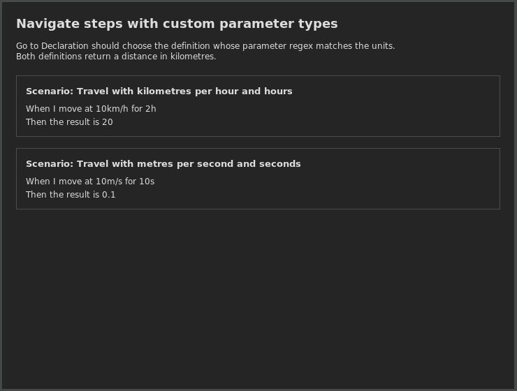

# Getting started

Cucumber for Scala connects `.feature` files to Scala step definitions written with the
Cucumber Scala DSL. Use the guides below for each feature.

| What you can do | Guide |
| --- | --- |
| Install the plugin and prepare a project or development environment | [Installation](installation.md) |
| Open the Scala definition of a feature step and find scenarios using a definition | [Step navigation](navigation.md#steps-and-definitions) |
| Match regular expressions, Cucumber expressions and custom parameter types | [Supported step patterns](navigation.md#supported-step-patterns) |
| Find hooks for a scenario | [Hook navigation](navigation.md#hooks) |
| Open requirements from feature tags | [Requirement navigation](navigation.md#requirements) |
| Inspect parameters, definitions and usages in Quick Documentation | [Step documentation](writing_steps.md#quick-documentation) |
| Complete step wording and edit generated sample arguments | [Completion](writing_steps.md#completion) |
| Create one missing step or a batch of definitions | [Step generation](writing_steps.md#create-step-definitions) |
| Rename steps or replace undefined wording with an existing step | [Step wording](writing_steps.md#rename-and-reuse-wording) |
| Find argument-count, parameter-type, Examples and style problems | [Inspections](writing_steps.md#inspections) |
| Edit tables, exchange spreadsheet cells and generate case classes | [Tables](tables.md) |
| Navigate and complete headers mapped to Scala case-class fields | [DataTable mappings](navigation.md#table-headers) |
| Browse, group and inspect steps and scenarios across a project or module | [Suite tab](workspace.md#suite) |
| View the implementation of the step under the feature caret | [Implementation tab](workspace.md#implementation) |
| Search scenarios by text or by related wording | [Scenario Search tab](workspace.md#scenario-search) |
| Run selected scenarios or Examples rows and rerun failures | [Running features](running.md#run-a-feature-scenario-or-examples-row) |
| Debug a feature step or a specific Examples row | [Feature breakpoints](running.md#debug-a-feature-step-or-examples-row) |
| Read result gutter markers and compare retained run outcomes | [Results](running.md#editor-results) and [Run History](workspace.md#run-history) |
| Preview feature documents and export HTML or PDF | [Preview and export](preview_and_export.md) |
| Add numbers to scenario titles | [Scenario numbering](writing_steps.md#number-scenario-titles) |
| Change project settings, requirement mappings and inspection options | [Configuration](configuration.md) |
| Identify gutter, result and breakpoint icons | [Icon reference](icons.md) |

For a small project to explore, see the [example guide](../example/README.md).
