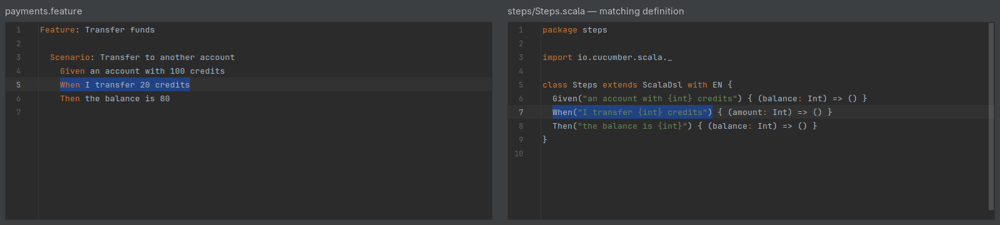

# Navigation

Navigation becomes available when project indexing finishes. A definition must be
available to the module containing the feature. For project and library prerequisites,
see [installation](installation.md#prepare-a-cucumber-scala-project).

## Steps and definitions

On a feature step, use **Go to Declaration** to open the matching Scala step definition.
When several definitions match, choose the intended target from the candidate list;
the plugin does not treat an ambiguous match as a single binding.

```gherkin
When I transfer 20 credits
```

```scala
When("I transfer {int} credits") { (amount: Int) =>
  transfer(amount)
}
```



On a Scala step-definition keyword, the Cucumber gutter icon opens its matching
scenarios. **Find Usages** also finds the feature steps that use the definition.
An outline counts as one scenario in the gutter's scenario count, and ambiguous
matches are included. A zero count describes the module's available feature files;
it does not establish that no other project uses a library step.

For a view that follows the feature caret without moving editor focus, use the
[Implementation tab](workspace.md#implementation).

## Supported step patterns

| Pattern | Example Scala step text | Matching feature text |
| --- | --- | --- |
| Anchored regular expression | `"""^I add (-?\d+) and (-?\d+)$"""` | `I add -5 and 6` |
| Slash-delimited regular expression | `"""/I add [0-9]+/"""` | `I add 42` |
| Built-in Cucumber parameters | `"I transfer {int} credits"` | `I transfer 20 credits` |
| Alternatives | `"I/We divide {double} by {double}"` | `I divide 10 by 2` or `We divide 10 by 2` |
| Optional text | `"I clear the operand(s)"` | `I clear the operand` or `I clear the operands` |
| Literal braces and parentheses | `"""the label reads \{result} \(preview)"""` | `the label reads {result} (preview)` |
| Constant concatenation | `"I divide " + (5 + 5) + " by " + (10 - 8)` | `I divide 10 by 2` |

Patterns assembled from runtime data cannot be resolved from their source alone.

### Custom parameter types

The regular expression in a `ParameterType` declaration decides which definition
matches. For example:

```scala
ParameterType("speed", """\d+km/h""") { text: String =>
  Speed(text.stripSuffix("km/h").toDouble)
}
When("I move at {speed}") { speed: Speed => move(speed) }
```

`When I move at 10km/h` opens that definition. A separate parameter type for `m/s`
can select a different definition. Write the parameter regex normally; the plugin
requires no additional escaping. See the
[custom-parameter example](../example/src/test/resources/cucumber/examples/scalacalculator/custom_parameters.feature).

## Hooks

Place the caret in a scenario and choose **Go to Scala Hooks…** from the editor context
menu. The chooser lists applicable Scala hooks whose tag expressions can be determined
from the source. Hooks with dynamic conditions remain unknown; the list does not
promise that every displayed hook will run.

## Table headers

A header can navigate to a case-class field when one Scala definition matches the
step and one `DataTableType` explicitly reads that header and passes its value to
the field's constructor argument:

```scala
case class TransferRow(account: String, amount: Int)
DataTableType { (entry: Map[String, String]) =>
  TransferRow(entry("owner"), entry("amount").toInt)
}
Given("transfers") { (rows: Seq[TransferRow]) => () }
```

In the corresponding step's table, `owner` opens `TransferRow.account`. Header
completion offers the mapped names, and the **Explicit DataTable header mapping**
[inspection](editing.md#inspections) reports headers the mapping does not read.
Matching a header to a case-class field by name alone does not create this link.
For other table edits, see [tables](editing.md#tables).

## Requirements

Once a [requirement mapping](configuration.md#requirement-mappings) exists, use
**Go to Declaration** on the mapped part of a feature tag such as `@REQ-PAY-12`.
Local destinations open the matching Markdown heading or explicit anchor. Multiple
matching anchors are offered as separate targets. URL destinations show a confirmation
before opening the browser.
