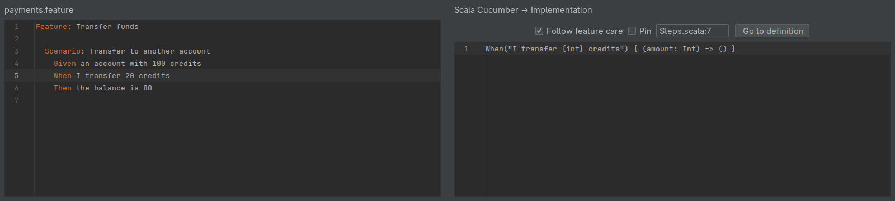
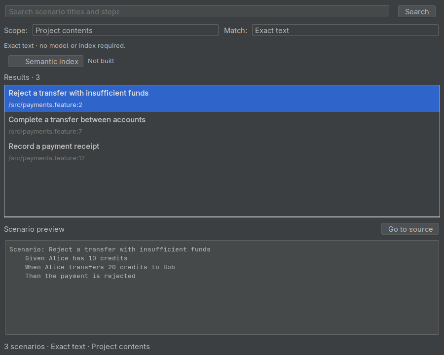
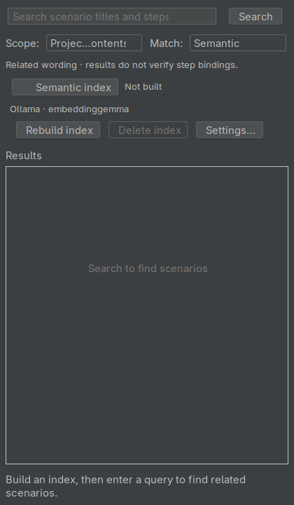

# Scala Cucumber workspace

Open **Tools → Scala Cucumber Suite** to show the **Scala Cucumber** tool window.
Its four tabs cover browsing, observed run outcomes, step implementations and scenario search.

## Suite

Choose **Project contents** or a module, then choose what to browse:

| View | What it shows |
| --- | --- |
| **Steps** | Scala step definitions and their expressions |
| **Scenarios** | Feature scenarios, with outlines counted once |
| **Undefined** | Feature steps with no matching definition |
| **Ambiguous** | Feature steps with several matching definitions |
| **Unused** | Definitions with no matching feature step in the selected scope |
| **Identical expressions** | Definitions declaring the same expression |
| **Duplicate scenarios** | Scenarios with the same ordered step bodies |

Use the text filter to narrow the list, and the step-kind selector for **Given**,
**When** or **Then** definitions. In **Scenarios**, a tag expression such as
`@smoke and not @ignored` filters scenarios by their tags. Group scenarios by
**Module**, **Tag** or **Category**; categories come from
[category mappings](configuration.md#scenario-categories).

Select an entry and use:

- **Go to source** to open its definition or feature location.
- **Preview** to inspect its source in a dialog.
- **Insert step** to insert a selected definition into the active feature editor,
  with editable sample arguments.
- **Run selection** to run selected scenarios. Select scenarios from one module at a time.

**Refresh** rebuilds the view for the selected scope; **Cancel** stops a pending refresh.
Findings describe the available source in that scope. An unused library step may
have consumers outside it, and matching or duplicate wording does not establish
execution coverage or business equivalence.

## Run History

The tab shows retained scenario outcomes when
[workspace history is enabled](configuration.md#run-results-and-history).
Use **Refresh** to update the list, **Open Current Scenario** to open the selected
scenario, or **Clear History** to remove the saved entries.

Results are grouped by scenario, source revision and runtime environment so that
different contexts remain separate. Details include the run time, outcome, attempt,
retry and error. Initial attempts and retries are counted separately. Mixed passing
and failing outcomes describe what happened; they do not identify the cause.
Renamed, changed or deleted scenarios do not transfer their old outcomes to a new
scenario at the same location.

## Implementation

Enable **Follow feature caret**, then move the caret to a feature step. The tab shows
its Scala implementation in a read-only editor while focus stays in the feature.
If several definitions match, select a candidate from the dropdown. **Pin** keeps
that implementation visible while you move elsewhere; **Go to definition** opens
the selected Scala source. An undefined step displays an explanation instead of a
candidate.

## Scenario Search

### Exact text

1. Choose **Scope**: **Project contents** or a module.
2. Leave **Match** as **Exact text**.
3. Enter words from a scenario title or body and click **Search**, or press Enter
   in the query field. An empty query lists the scenarios in that scope.
4. Select a result to reveal its preview. Use **Go to source**, Enter in the result
   list, or a double-click to open the feature location.

Each result shows the scenario title and its file and line. Exact text search needs
no model or semantic index.

### Semantic search

Semantic search finds related wording using an embedding model. First complete the
[optional model setup](installation.md#prepare-optional-semantic-search) and
[provider configuration](configuration.md#scenario-semantic-search).

1. Choose the scope and set **Match** to **Semantic**. The **Semantic index** controls expand.
2. Click **Rebuild index** to send the scope's scenario text to the configured server
   and build an index in memory.
3. Enter a query and click **Search**. The query is sent to the same server for comparison.
4. Inspect the returned scenarios and their similarity scores before opening the source.

The search returns up to 50 related scenarios. Similarity suggests wording to inspect;
it does not prove step binding or coverage. The index is not saved to disk. Feature
edits or deletions, a scope change, or a provider/model change invalidate it; rebuild
when requested. **Delete index** removes it from memory. **Cancel** stops a pending
search or rebuild. If the model server is unavailable, **Exact text** remains usable.

